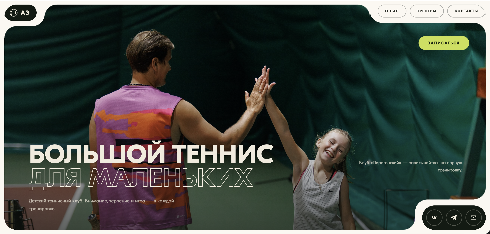
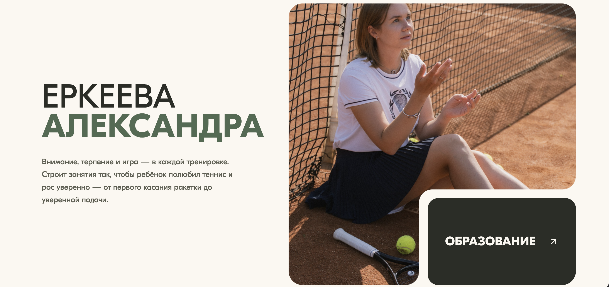
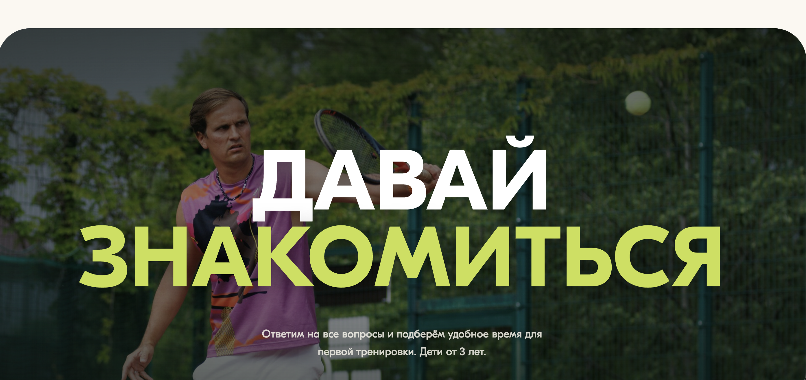

# Лендинг Психолого и теннисного клуюа

Проект лендинг страницы для тренеров в теннисном клубе.

---

## Содержание

- [Статус проекта](#статус-проекта)
- [Ссылка на проект](#ссылка-на-проект)
- [Используемые технологии](#используемые-технологии)
- [Пример работы](#пример-работы)

---

## Статус проекта

В разработке

---

## Ссылка на проект

```

```

---

## Используемые технологии

- ReactJS
- JavaScript
- TypeScript
- HTML
- Module.css
- Cursor
- n8n
- framer-motion
- CLAUDE DESIGN

---

## Пример работы




